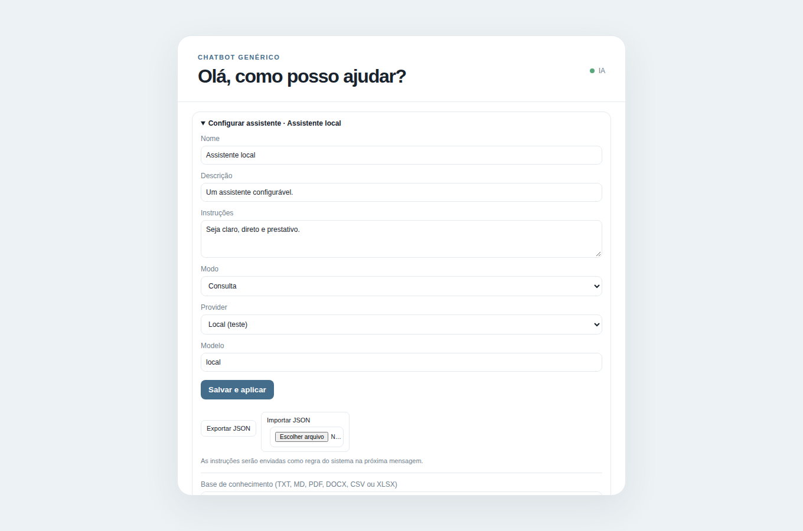

# Chatbot configurável

Configure assistentes para tarefas diferentes, escolha um provedor, mantenha conversas e consulte documentos com as fontes exibidas junto às respostas.



Captura do modo Local (teste), sem chave de API.

## Executar

Requer Node.js 24 ou superior e npm.

```bash
npm install
npm run dev
```

Abra http://localhost:3000. Para usar um provedor externo, copie .env.example para .env.local e configure OPENROUTER_API_KEY ou GEMINI_API_KEY. O [guia de configuração dos provedores](docs/guides/configurar-provedores.md) explica as opções.

## O que oferece

- Instruções, modelo e provedor configuráveis por assistente.
- Modos de consulta, tutor e avaliação.
- Base de conhecimento com arquivos TXT, Markdown, PDF, DOCX, CSV e XLSX.
- Respostas acompanhadas dos trechos usados como fonte.
- Histórico de conversas e importação/exportação de configurações em JSON.

O banco SQLite é criado em data/chatbot.sqlite. Não versione o banco, documentos enviados ou chaves de API.

## Arquitetura

A aplicação usa Next.js e TypeScript, uma API própria para os provedores de linguagem e embeddings, e SQLite para persistência. Na versão atual, os embeddings ficam em JSON e a similaridade cosseno é calculada em TypeScript.

## Documentação

- [Configurar um provedor](docs/guides/configurar-provedores.md)
- [Índice das macroetapas](INDICE.md)
- [Planos de implementação](macroetapas/)
